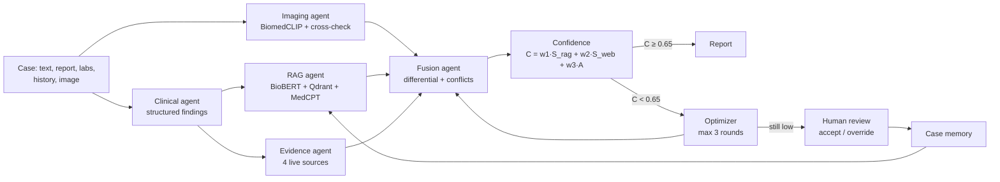

# MedOrchestrate

**Confidence-aware, multi-agent reasoning for multimodal clinical decision support.**

MedOrchestrate takes whatever is known about a patient (a clinical description, a medical report, lab values, past
history, and an optional chest X-ray, head CT or brain MRI) and returns a ranked differential diagnosis with cited
evidence, an explicit confidence score, and a clear signal for when a clinician must review the case.

> **Research prototype. Not a medical device.** It supports, and never replaces, clinical judgement. It has not been
> clinically validated and must not be used to make decisions about real patients. See [Limitations](#limitations-and-responsible-use).

## Why it is different

- **Evidence you can check.** Every diagnosis is tied to retrieved passages from a curated, cited knowledge base and to
  live literature (PubMed, MedlinePlus, Europe PMC, ClinicalTrials.gov), each with its source.
- **It knows when it does not know.** Confidence is computed from the evidence actually found, not asserted by a model.
  Vague input, missing clinical anchors or weak evidence cap the score and route the case to a clinician.
- **Image and text reasoned together.** A biomedical vision model reads the image, a second multimodal read cross-checks
  it, and contested image findings are kept out of the diagnosis instead of silently steering it.
- **Self-correcting, but bounded.** When confidence is below the 0.65 threshold an optimizer re-queries with new
  strategies, at most three rounds, then hands over to a human.
- **Learns from clinicians.** Accept or override decisions are stored as retrievable case memory (text and visual), and
  the confidence weights can be recalibrated from real outcomes once enough reviews exist.

## How it works



The pipeline is orchestrated with CrewAI. Details, including the input-sufficiency gate, case memory and recalibration,
are in [docs/ARCHITECTURE.md](docs/ARCHITECTURE.md).

| Layer | Technology |
|---|---|
| API | Python, FastAPI (synchronous and async job endpoints) |
| Orchestration | CrewAI |
| Language models | Pluggable: Gemini (used for all recorded runs), Claude (Anthropic, Bedrock, Vertex), Mistral |
| Retrieval | BioBERT embeddings, Qdrant, MedCPT cross-encoder reranker |
| Imaging | BiomedCLIP zero-shot classification, optional multimodal LLM cross-check |
| Frontend | React, Vite, Tailwind CSS |
| Storage | SQLite (cases, reports, reviews, weight history) |

## Quick start

**Requirements:** Python 3.10+ (3.11 in the Docker image), Node.js 18+, about 5 GB of free disk for the models, and an
API key for one LLM provider (a free [Gemini](https://aistudio.google.com) key is enough for single cases).

```bash
# 1. Backend environment
python -m venv venv
venv\Scripts\activate            # macOS / Linux: source venv/bin/activate
pip install -r requirements.txt

# 2. Configuration: copy the template and add your key (GEMINI_API_KEY for the default setup)
cp .env.example .env

# 3. One-time: build the offline knowledge base (downloads BioBERT on first run)
python -m backend.rag.ingest

# 4. Run the backend (terminal 1)
python -m uvicorn backend.main:app --host 127.0.0.1 --port 8000

# 5. Run the frontend (terminal 2)
cd frontend && npm install && npm run dev
```

Open <http://localhost:5173>, enter a case and watch it process. On Windows, `scripts\start_regular.bat` starts both
servers and opens the site. API docs are at <http://localhost:8000/docs>, health at `/health`.

The first case after a restart is the slowest (models load on first use), and a case takes roughly 30 to 60 seconds.
Without a key the backend degrades gracefully: `/diagnose` returns a clean error instead of a diagnosis.

### Try it

`data/test_cases/` holds example inputs, and `data/images/real/` holds attributed demonstration images. Typical outcomes:
a clear text-and-image case is answered without review; a vague input ("generally unwell, mild fatigue") is capped at
0.60 confidence and sent for review, with a notice explaining why.

## API

| Endpoint | Purpose |
|---|---|
| `POST /diagnose` | Analyse a case (multipart form: age, sex, clinical text, report, history, labs, image) |
| `POST /diagnose?async=true` | Same, but returns `202` with a case id immediately |
| `GET /diagnose/{case_id}/status` | Live progress: step-by-step status, queue position, report when done |
| `GET /diagnose/{case_id}` | The stored report |
| `POST /review/{case_id}` | Clinician accept or override; overrides become case memory |
| `GET /review/{case_id}` | The stored review |
| `GET /health` | Liveness check |

## Configuration

Set in `.env`; only `LLM_PROVIDER` and its key are needed to start.

| Variable | Purpose |
|---|---|
| `LLM_PROVIDER` | `gemini` (as in `.env.example`), `anthropic` (code default), `bedrock`, `vertex`, `mistral` |
| `GEMINI_API_KEY` / `ANTHROPIC_API_KEY` | Key for the chosen provider |
| `IMAGING_CROSS_CHECK` | `on` enables the second image read that flags contested findings |
| `QDRANT_URL` | Blank uses an embedded local store; set it to use a Qdrant server |

All variables, their defaults and the reasoning behind them: [docs/CONFIGURATION.md](docs/CONFIGURATION.md).

## Testing

```bash
pytest                                   # 649 backend tests, offline (external calls mocked), about 40 s
cd frontend
npm test                                 # unit and component tests
npm run test:e2e                         # browser end-to-end tests against a faked backend
```

## Evaluation

How the system was measured, with caveats, is in [docs/EVALUATION.md](docs/EVALUATION.md): in-house and public-benchmark
case sets, a retrieval check, and a real-image imaging benchmark (88 open-licence chest X-rays, head CTs and brain MRIs,
reported with Wilson 95% intervals and chance and majority baselines).

| Imaging component, zero-shot (88 images) | Result |
|---|---|
| Correct modality detected | 94% (83/88) |
| Correct finding, top-1 / top-3 | 57% / 82% |
| Abnormal vs normal, sensitivity / specificity | 94% / 57% |

These figures describe one model on a small, hand-picked, optimistic set with uploader-assigned labels. They are not
the system's diagnostic accuracy, and the confidence threshold and weights are likewise unvalidated.

## Sharing a live demo

[DEPLOY_DEMO.md](DEPLOY_DEMO.md) explains how to let reviewers try the app from a phone or browser through a free tunnel
from one laptop, behind a shared password with per-visitor and total case limits (`scripts\start_demo.bat`). No Docker
or paid hosting is needed. [DEMO_READINESS.md](DEMO_READINESS.md) records the pre-demo checklist and what was verified.
A development-oriented Docker setup is in [docs/DOCKER.md](docs/DOCKER.md).

## Project structure

```
backend/
  main.py            FastAPI app          demo_app.py / demo_guard.py   shared-password demo server and its limits
  api/               routes and API schemas
  agents/            clinical, imaging (+ cross-check), rag, evidence, fusion, optimizer
  rag/               embeddings, ingest, retrieval, reranker, case and visual memory
  services/          orchestrator, confidence, jobs, storage, weight tuner, LLM client, logging
  models/schemas.py  shared Pydantic contracts used by every agent and route
  tests/             649 offline tests
frontend/            React app: submission, processing, report and review screens
data/                knowledge base, example cases, images, imaging benchmark
scripts/             launchers, evaluation and benchmark tools
docs/                architecture, configuration, evaluation, Docker
```

## Limitations and responsible use

- Not clinically validated. No clinician has reviewed its outputs yet; the reviews recorded so far come from test users.
- The knowledge base is small (67 passages of real, cited MedlinePlus and PubMed content), so coverage of conditions is limited.
- Imaging support covers chest X-ray, head CT and brain MRI only, and uses a zero-shot model whose accuracy on real
  images is modest (see Evaluation). Findings are read from teaching-quality images; messy clinical images will be harder.
- The 0.65 confidence threshold, the formula weights and the safety caps are chosen values, not fitted ones.
- Output depends on the LLM provider; every recorded run used Gemini, and the Claude path is implemented and unit-tested
  but not exercised end to end here.
- Do not enter real patient data. Demonstration images are open-licence and attributed in `data/images/real/ATTRIBUTION.md`
  and `data/benchmarks/imaging_real/`.
